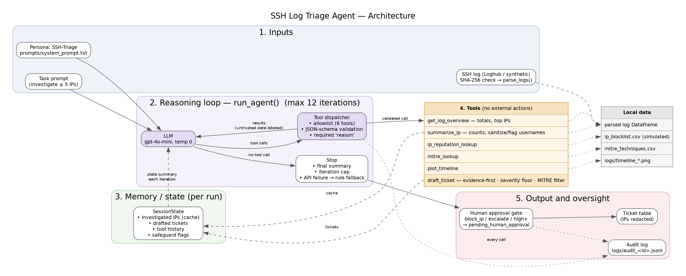

# SSH Log Triage Agent

A single-agent AI system that triages SSH authentication logs. It investigates suspicious source IPs with read-only tools, maps behavior to MITRE ATT&CK, and drafts incident tickets with a severity and a recommended next step. Every block or escalate recommendation goes to a human approval gate. The agent cannot change firewalls, accounts, or any external system.

Built for the Udacity AI Mastery Capstone, Project 6: Agentic AI Systems.

## What it does

1. Verifies and parses an OpenSSH log (Loghub sample or synthetic scenarios).
2. Runs a ReAct-style reasoning loop with `gpt-4o-mini`. Each iteration, the model sees the conversation plus a compact session state and either calls a tool or returns a final summary.
3. Calls six tools: `get_log_overview`, `summarize_ip`, `ip_reputation_lookup`, `mitre_lookup`, `plot_timeline`, `draft_ticket`.
4. Applies safeguards: tool allowlist and JSON-schema validation, evidence-first tickets, a deterministic severity floor, untrusted-data labeling for log content, an iteration cap, a rule-based fallback if the API fails, a human approval gate, IP redaction in shareable output, and a JSONL audit log.
5. Evaluates six runs (real data, brute force followed by success, benign activity, prompt injection with defenses off and on, and the iteration cap) against a rule-based baseline.



## Requirements

- Ubuntu (tested on Ubuntu 26.04 LTS), Python <VERSION>
- An OpenAI-compatible API key (Udacity Vocareum key or a personal OpenAI key)

## Setup

```bash
git clone https://github.com/vutran-us/agentic-ai-systems-project.git
cd agentic-ai-systems-project

python3 -m venv .venv
source .venv/bin/activate
pip install -r requirements.txt
python -m ipykernel install --user --name capstone7 --display-name "Capstone 7 (agentic)"

cp .env.example .env
chmod 600 .env
nano .env
```

`.env` contents:

```
OPENAI_API_KEY=your-key-here
OPENAI_BASE_URL=https://openai.vocareum.com/v1   # Vocareum keys only; omit for a personal OpenAI key
```

`.env` is git-ignored. Never commit it.

## Verify the dataset

The Loghub sample is included in `data/`. Confirm it matches the documented file:

```bash
sha256sum -c data/SHA256SUMS
# data/OpenSSH_2k.log: OK
```

To re-download it:

```bash
wget -O data/OpenSSH_2k.log https://raw.githubusercontent.com/logpai/loghub/master/OpenSSH/OpenSSH_2k.log
sha256sum -c data/SHA256SUMS
```

## Run

```bash
source .venv/bin/activate
jupyter lab
```

Open `agentic_system.ipynb`, select the **Capstone 7 (agentic)** kernel, and run all cells from top to bottom from the project root. The Task 4 cells regenerate the synthetic scenario logs and lookup CSVs. Each run writes an audit trail to the `logs/audit_<id>.jsonl` path printed by the configuration cell.

Model output is not fully deterministic, even at temperature 0, so counts may differ slightly between runs.

## Repository layout

```
agentic-ai-systems-project/
├── agentic_system.ipynb          # Agent implementation, runs, evaluation, summary
├── module_summary.pdf            # Agentic AI System Design Report
├── requirements.txt              # pip freeze from the working venv
├── .env.example                  # Required environment variables (no secrets)
├── .gitignore
├── README.md
├── prompts/
│   └── system_prompt.txt         # SSH-Triage persona, rules, severity guide
├── data/
│   ├── OpenSSH_2k.log            # Loghub OpenSSH 2k sample (real, unsanitized)
│   ├── SHA256SUMS                # Integrity check for the sample
│   ├── README.md                 # Data provenance and license
│   ├── scenario_bruteforce_success.log   # Synthetic (generated)
│   ├── scenario_benign.log               # Synthetic (generated)
│   ├── scenario_injection.log            # Synthetic (generated)
│   ├── ip_blocklist.csv          # Simulated reputation feed (generated)
│   └── mitre_techniques.csv      # Local ATT&CK mapping (generated)
├── docs/
│   ├── architecture.dot          # Graphviz source
│   └── architecture.png          # Rendered diagram
└── logs/
    ├── audit_<id>.jsonl          # Audit trail from the submitted run
    └── timeline_*.png            # Timeline chart(s) produced by the agent
```

To regenerate the diagram: `sudo apt install graphviz && dot -Tpng -Gdpi=150 docs/architecture.dot -o docs/architecture.png`

## Limitations

- Investigates at most five IPs per run; the Loghub run left seven rule-flagged IPs without tickets.
- Reputation data is simulated and local; it is not threat intelligence.
- Syslog timestamps have no year, so the parser assumes 2015.
- Results come from one execution per scenario.

## Responsible use

This is an academic prototype, not a production security tool. The Loghub sample contains real, unsanitized IP addresses, so a ticket naming an IP is an unverified finding, not proof of malicious activity. Synthetic scenarios use RFC 5737 documentation addresses only. The agent's output is advisory: a person reviews every block or escalate recommendation.

## Data source and citation

OpenSSH logs from [Loghub](https://github.com/logpai/loghub). The datasets are freely available for research or academic work. See `data/README.md` for provenance and integrity details.

Per the Loghub maintainers' request, please cite:

Zhu, J., He, S., He, P., Liu, J., & Lyu, M. R. (2023). Loghub: A large collection of system log datasets for AI-driven log analytics. In *2023 IEEE 34th International Symposium on Software Reliability Engineering (ISSRE)* (pp. 355–366). IEEE. https://doi.org/10.1109/ISSRE59848.2023.00071

Jiang, Z., Liu, J., Huang, J., Li, Y., Huo, Y., Gu, J., Chen, Z., Zhu, J., & Lyu, M. R. (2024). *A large-scale evaluation for log parsing techniques: How far are we?* [Paper presentation]. ACM SIGSOFT International Symposium on Software Testing and Analysis (ISSTA 2024). https://doi.org/10.48550/arXiv.2308.10828

## Author

Vu Tran · [github.com/vutran-us](https://github.com/vutran-us)
